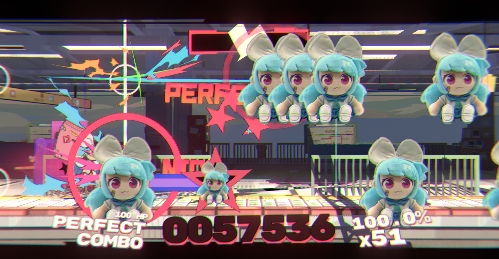

# UNBEATABLE Custom Silence

A mod to modify the appearance of the silence in the hit rhythm game UNBEATABLE!

Quaver silence example shown above.

## Configuration

To load a custom silence image, simply put an image file called `silence.png` or `silence.jpg` inside the same folder as the mod DLL file. 

The image file is reloaded on every song restart, and if it is not present will simply show the normal silence sprites (i.e., you can easily disable it by simply renaming or deleting the image).

There are also some options available in the BepInEx configuration file:

**Custom Silence Enabled** is an easy global toggle for turning the features of the mod on and off.

There are also options for each specific note type to change the scale of the image in case you want the custom silence images to be bigger or smaller.

## Mod Installation Instructions

For installation instructions, refer to my mod installation guide here:

<https://gist.github.com/Stefyfresh/1140bf18c5f3895bd807258c16483887>

---

###### All code for Custom Silence was written by me, by hand.